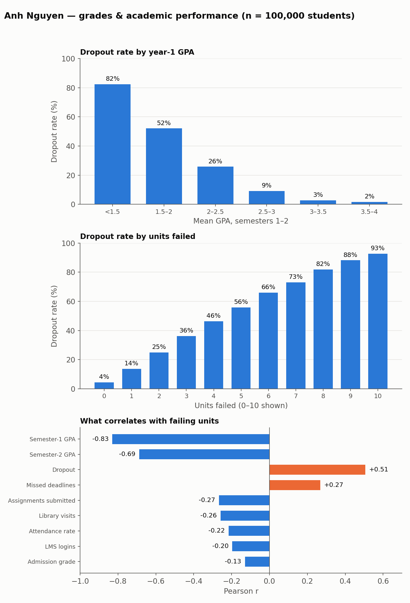
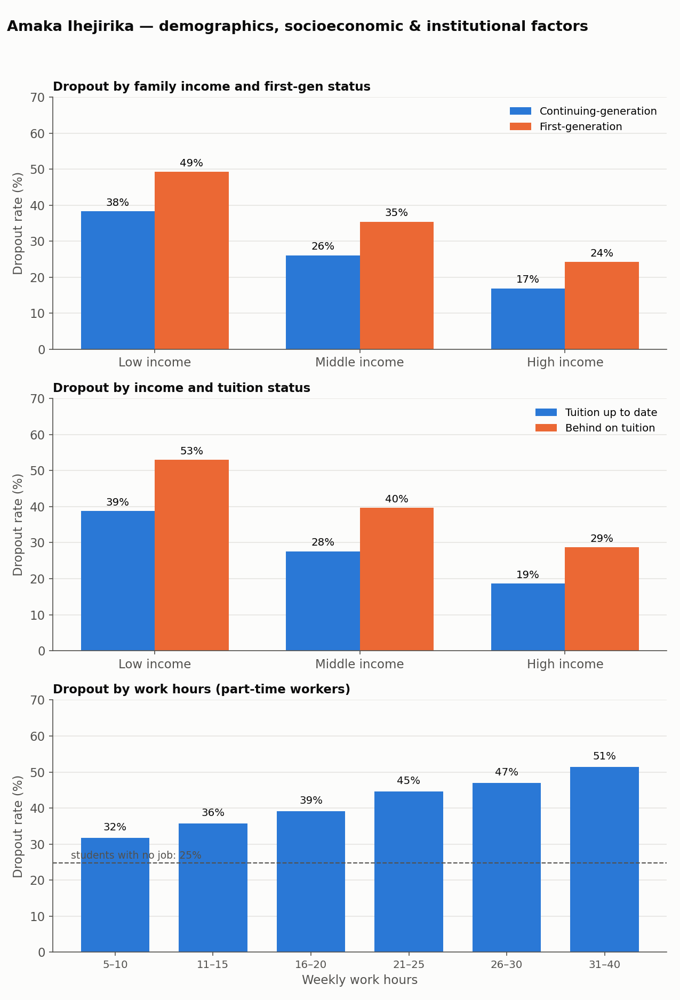
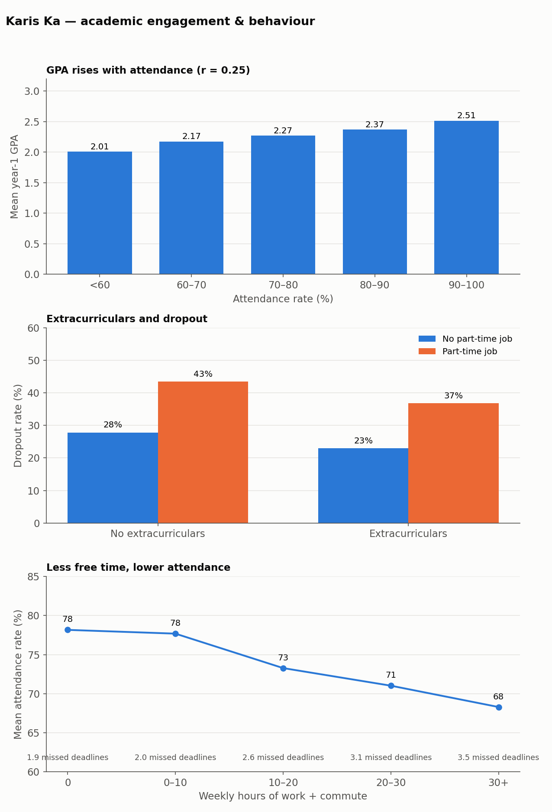
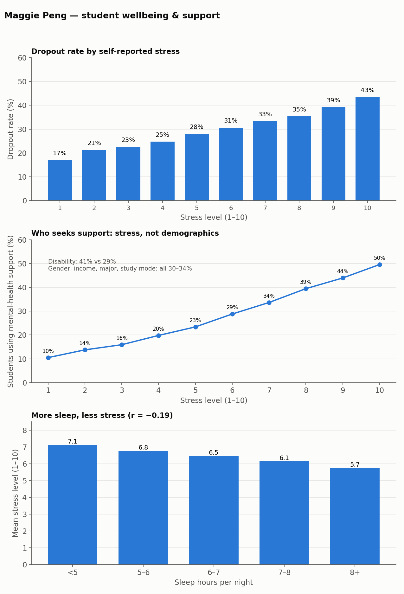
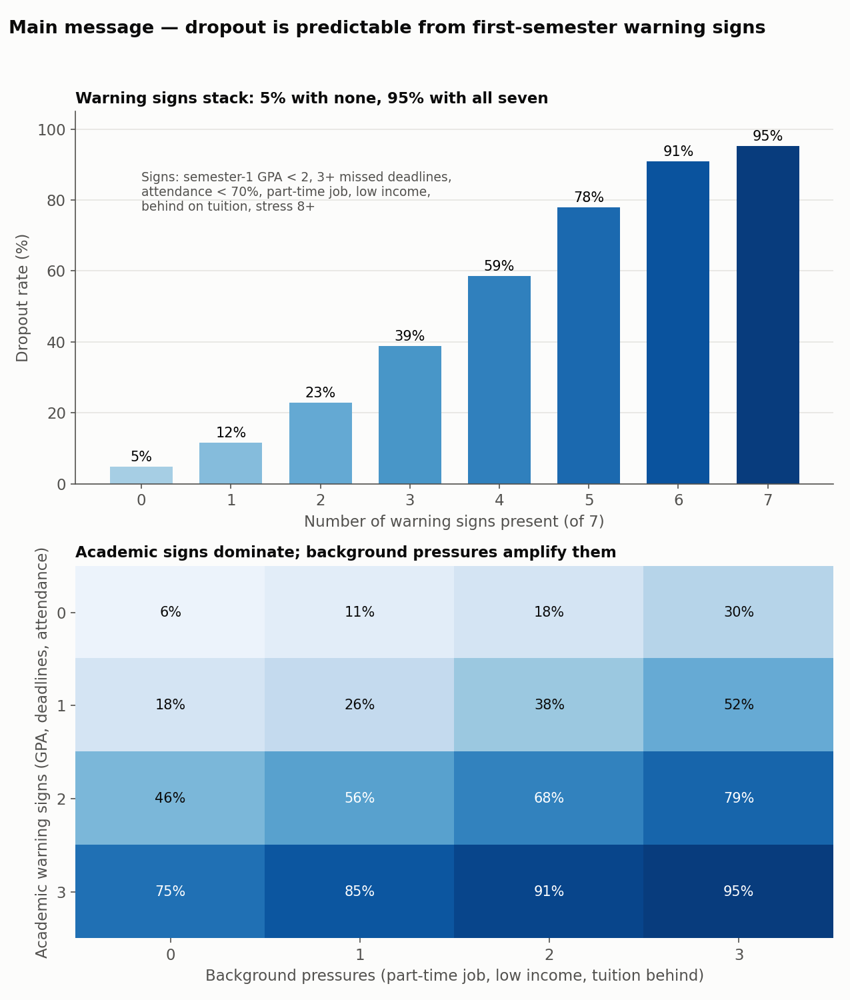
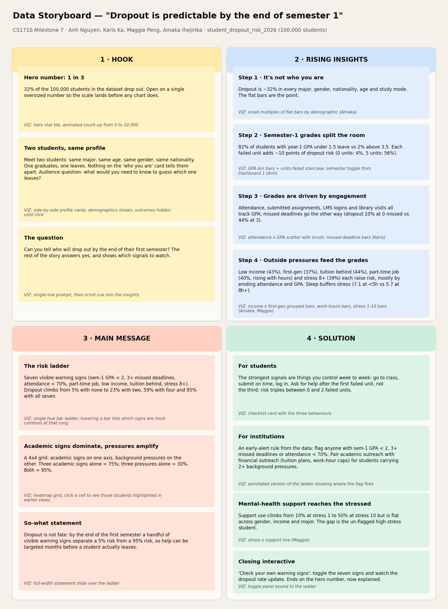

# Milestone 7 Submission — Main Message and Data Storyboard

Process book (anyone with the link can view): https://docs.google.com/document/d/1yUBoKTumUW06p0g8fcB6EA3Qu_pfeiUeGBxGHq7538Q/edit

Team: Anh Nguyen, Karis Ka, Maggie Peng, Amaka (Chiamaka) Ihejirika. Audience: college students.

## How we explored the data

We worked from student_dropout_risk_2026.csv: 100,000 students, 33 attributes, no missing values. Overall, 32.0% of students in the dataset dropped out (dropout = 1). Each member explored their own section of the data breakdown above (grades, background, engagement, wellbeing) in Python with pandas and matplotlib, cross-checking against the Milestone 6 dashboards. Throughout, “dropout rate” means the share of students in a group with dropout = 1, and r is a Pearson correlation. The data is observational, so every finding below is an association, not a cause.

One shared observation framed the whole discussion: dropout is flat across every identity attribute. It is 31.7–32.1% in all five course types, 31.9% for women and 32.0% for men, 30–33% in every nationality, 31–34% at every age from 15 to 30, and 32.0% for domestic and 32.1% for international students. Whatever predicts dropout, it is not who the student is.

## Individual insights

### Anh Nguyen — grades and academic performance

- **Insight 1 (Q1): year-1 GPA is the strongest single signal in the dataset.** Averaging semesters 1 and 2, dropout falls from 82% for students under a 1.5 GPA to 52% (1.5–2), 26% (2–2.5), 9% (2.5–3), 3% (3–3.5) and 2% (3.5–4); the correlation with dropout is r = −0.57, double anything outside the grades block. Semester-1 GPA alone is almost as strong (r = −0.57): 87% of students with a first-semester GPA under 1.5 leave, versus 2% of those above 3.5. In other words, the risk is readable after one semester, not one year. A side finding: GPA slides from semester 1 to semester 2 for almost everyone (mean 2.57 to 1.98), so the dropouts are not the only ones falling; they simply start lower (1.91 vs 2.88) and have less room.

- **Insight 2 (Q2): every failed unit adds roughly ten points of dropout risk.** Dropout is 4% with 0 failed units, 14% with 1, 25% with 2, 36% with 3, 46% with 4, 56% with 5, 73% with 7 and 93% with 10. The staircase is almost perfectly linear, which makes it an easy visual. Measured as a share of enrolled units, the pattern is the same: 4% dropout when nothing is failed, 18% under 20% failed, 45% at 20–40%, and 80% above 40%. 97.6% of all students who dropped out failed at least one unit.

- **Insight 3 (Q3): failing is driven by what students do during the semester, not what they arrived with.** The share of units failed correlates most with semester-1 GPA (r = −0.83) and then with engagement behaviours: missed deadlines (+0.27), assignments submitted (−0.27), library visits (−0.26), attendance (−0.22) and LMS logins (−0.20). Entry qualifications hardly register: admission grade is −0.13 and previous qualification grade is −0.03. Weekly work hours is +0.08. This is the bridge to Karis’s section: grades are the signal, but engagement is what moves them.

### Amaka Ihejirika — demographics, socioeconomic and institutional factors

- **Insight 1 (Q1): first-generation students drop out more, and the gap is not just income.** 37.4% of first-generation students drop out versus 28.1% of continuing-generation students. The gap holds inside every income band: 49% vs 38% among low-income students, 35% vs 26% among middle-income, 24% vs 17% among high-income. A first-generation student from a high-income family still drops out more often than a continuing-generation student from a middle-income family.

- **Insight 2 (Q2): low-income students show the early warning signs earlier and more often.** Dropout is 43% for low-income, 30% for middle-income and 20% for high-income students. Low-income students enter the first semester with a lower mean GPA (2.44 vs 2.72 for high-income) and work more hours (10.7 vs 6.4 per week). Falling behind on tuition is a strong institutional flag: 44% of students behind on tuition drop out versus 29% of those up to date, and within the low-income group it is 53% vs 39%. Holding a scholarship barely moves the rate (31% vs 33%). Grades still dominate, though: a low-income student with a first-semester GPA of 3 or higher drops out 8% of the time, while a high-income student with a GPA under 2 drops out 61% of the time. Income shifts the curve; it does not replace it.

- **Insight 3 (Q3): among students with part-time jobs, every extra block of hours raises dropout.** 39.8% of students with a part-time job drop out, against 24.7% without one. Within the 48,192 working students the relationship is dose-dependent: 32% at 5–10 hours a week, 36% at 11–15, 39% at 16–20, 45% at 21–25, 47% at 26–30 and 52% at 31–40. Working students who dropped out averaged 19.1 hours against 17.5 for those who stayed, and their attendance was 66% against 76%, which is how the hours appear to reach the grades.

### Karis Ka — academic engagement and behaviour

- **Insight 1 (Q1): missing class costs grades, and missed deadlines cost even more.** Attendance correlates with GPA at r = 0.25 (0.26 for semester 1). Mean year-1 GPA climbs from 2.01 for students attending under 60% of classes to 2.51 at 90–100%, and dropout falls from 53% to 16% across the same bins. Other engagement measures are at least as strong as attendance: assignments submitted (r = 0.31 with GPA), library visits (0.30) and missed deadlines (−0.31). Missed deadlines are the sharpest early indicator: dropout is 10% with 0 missed, 28% with 1, 39% with 2, 44% with 3 and around 50% from 5 upward. LMS logins show the same shape (44% dropout under 5 logins a week vs 16% above 15).

- **Insight 2 (Q2): extracurricular involvement goes with lower dropout, even after accounting for jobs.** Students with extracurricular activities drop out 29.1% of the time, versus 36.3% without. Their GPAs are nearly identical (2.29 vs 2.25), and part of the difference is that involved students work fewer hours (7.8 vs 10.1 a week). But the gap survives inside each group: 23% vs 28% among students with no job, and 37% vs 43% among students with a part-time job. Involvement looks protective rather than just a marker of free time.

- **Insight 3 (Q3): less free time means less showing up, not less logging in.** Using the Dashboard 1 measure of weekly time commitment (work hours plus five commutes), students with zero committed hours average 78% attendance, 1.9 missed deadlines and 24% dropout; students at 30+ hours average 68% attendance, 3.5 missed deadlines and 50% dropout. Time commitment correlates −0.18 with attendance, +0.20 with missed deadlines, −0.11 with extracurricular participation and −0.13 with sleep. Two surprises: commute time alone has essentially no relationship with anything (every |r| < 0.01; it is the work hours that matter), and online engagement is untouched (LMS logins r = −0.02, library visits −0.03). Busy students keep logging in; they stop attending and submitting on time.

### Maggie Peng — student wellbeing and support

- **Insight 1 (Q1): dropout rises steadily with self-reported stress, but stress is a weaker signal than grades.** Dropout climbs monotonically from 17% at stress level 1 to 25% at 4, 28% at 5, 33% at 7, 39% at 9 and 43% at 10, and students who dropped out report a mean stress of 6.9 against 6.3 for those who stayed. The correlation with dropout is r = 0.13, meaningful but a quarter of the GPA signal. Satisfaction is its mirror image: 44% dropout at a satisfaction score of 1 versus 25% at 10.

- **Insight 2 (Q2): students seek mental-health support in proportion to their stress, and almost nothing else predicts it.** 31.6% of students use mental-health support. Use rises from 10% at stress 1 to 23% at stress 5 and 50% at stress 10. Students with a disability use it far more (41% vs 29%) and first-generation students slightly more (33% vs 30.5%). Gender (31–32%), family income (30–34%), course type, study mode, nationality and international status are all flat. Because support follows distress, supported students report higher stress (7.1 vs 6.1) and slightly lower satisfaction, and at any given stress level dropout is about the same with or without support (for example 36% vs 35% at stress 8). Support is reaching the stressed; it is not yet visibly changing outcomes in this data.

- **Insight 3 (Q3): students who sleep more report less stress.** Sleep and stress correlate at r = −0.19. Mean stress is 7.1 for students sleeping under 5 hours, 6.8 at 5–6, 6.5 at 6–7, 6.1 at 7–8 and 5.7 at 8 or more. The same gradient appears in outcomes: dropout is 37% for the under-5-hour group and 28% for the 8-plus group, and satisfaction rises from 6.1 to 6.5. Sleep looks like a buffer that sits underneath the stress signal.

## Team discussion and main message

We compared the four sets of insights against three tests: is it surprising, is it something our audience can act on, and does the data support it strongly. Four candidates came out of the discussion.

- Grades (Anh): year-1 GPA and failed units predict dropout far better than anything else, and the risk is visible after one semester. Strongest evidence, but on its own it reads as “bad grades, drop out”, which nobody finds surprising.

- Background (Amaka): income, first-generation status, tuition and part-time work all raise dropout, and each mostly works by eroding attendance and GPA. Important and relevant to students, but the effects are moderate next to grades.

- Engagement (Karis): attendance, deadlines and logins are what move grades, and they are behaviours a student controls week to week. The most actionable section.

- Wellbeing (Maggie): stress and sleep track dropout, and support use tracks stress. True and relatable, but the weakest numerically.

What tied them together was the flatness of the demographic attributes. Major, gender, nationality and age do not predict dropout at all, while a small set of observable signals from the first semester predicts it almost completely. We tested this by counting seven warning signs for each student: semester-1 GPA under 2, three or more missed deadlines, attendance under 70%, a part-time job, low family income, being behind on tuition, and stress of 8 or more. Dropout is 5% with none of these signs, 12% with one, 23% with two, 39% with three, 59% with four, 78% with five, 91% with six and 95% with all seven. Splitting the signs into academic (GPA, deadlines, attendance) and background (job, income, tuition) shows that the academic signs do most of the work (75% dropout with all three academic signs and no background pressures, versus 30% with all three background pressures and no academic signs) and that background pressures amplify them (95% with both).

**Main message (our “so what” in one sentence):** Dropout is not fate: by the end of the first semester, a handful of visible warning signs — grades, missed deadlines, attendance, work hours, money and stress — separate a 5% dropout risk from a 95% one, so students and schools can act months before anyone actually leaves.

**Why we chose it.** It is the only message that uses all four of our sections, it leads with a genuinely surprising fact for our audience (who you are predicts nothing; what happens in semester one predicts almost everything), it is directly actionable for a college student reading it, and it is the best-supported claim in the data: the warning-sign ladder runs from 5% to 95% with 100,000 students behind it. It also grows naturally out of our Milestone 6 dashboards, which already link behaviours to grades (Dashboard 1) and work and stress to dropout (Dashboard 2).

## Data storyboard

We built the storyboard digitally as four columns matching the story structure. Each card names the visualization it will become and which team member’s section it draws on.

**Reading order and ownership**

- Hook (all): an animated hero number (1 in 3 students drops out), then two student profile cards with identical demographics and hidden outcomes, ending on the question “can you tell who will leave by the end of their first semester?”

- Rising insight 1 (Amaka): small multiples of flat dropout bars by major, gender, nationality, age and study mode. It is not who you are.

- Rising insight 2 (Anh): dropout by GPA bin and the failed-units staircase, reusing the semester toggle from Dashboard 1. Semester-one grades split the room.

- Rising insight 3 (Karis): attendance-by-GPA scatter with brushing and missed-deadline bars. Grades are driven by engagement.

- Rising insight 4 (Amaka and Maggie): income-by-first-generation grouped bars, work-hours bars for part-time workers, and dropout by stress level 1–10. Outside pressures feed the grades.

- Main message (all): the warning-sign ladder (0 to 7 signs, 5% to 95%) with hover showing which signs are most common at each rung, and the academic-by-background heat-map grid with click-to-highlight into the earlier views, followed by the one-sentence statement.

- Solution (all): a checklist card for students (attend, submit on time, ask for help after the first failed unit), an annotated ladder showing where an institutional early-alert rule would fire (semester-1 GPA under 2, three missed deadlines or attendance under 70%, paired with financial outreach for students carrying two or more background pressures), Maggie’s stress-by-support line showing that support reaches the stressed, and a closing “check your own warning signs” toggle panel that ends on the hero number again.

Figures in this section were generated from the dataset in Python; the image files are in the shared Drive folder “CS1710 Milestone 7 figures” (https://drive.google.com/drive/folders/1ddI9b6bPBjM_7LWtG8JfSiJaeRplz8tf).

